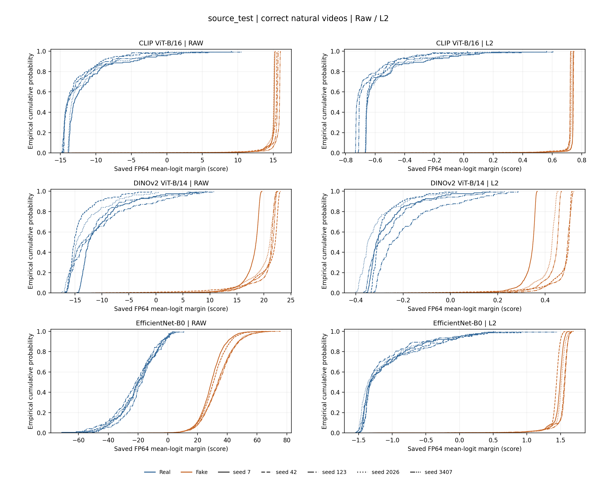
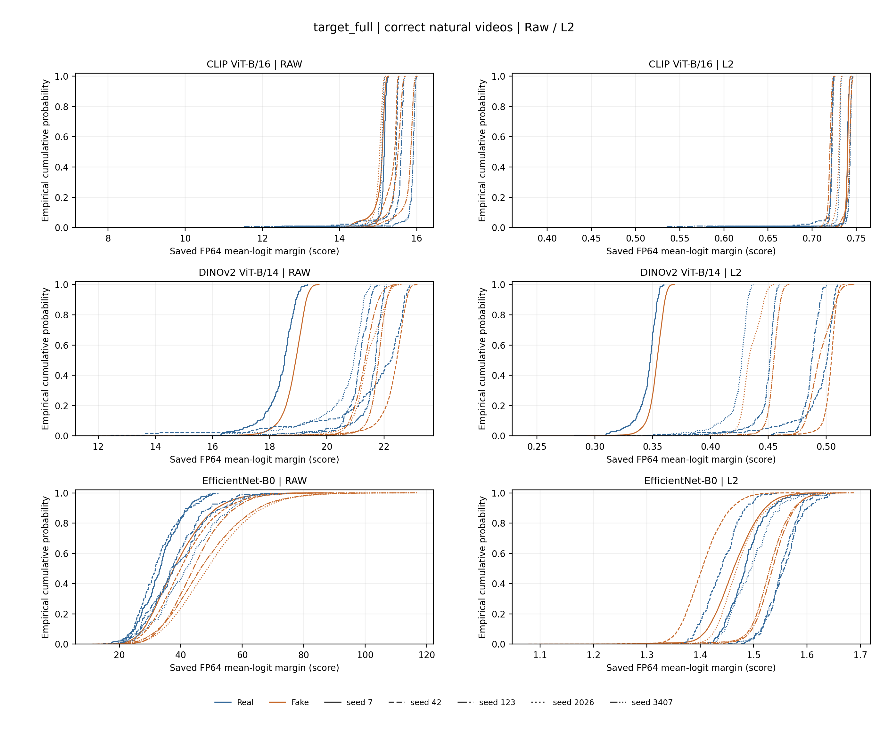
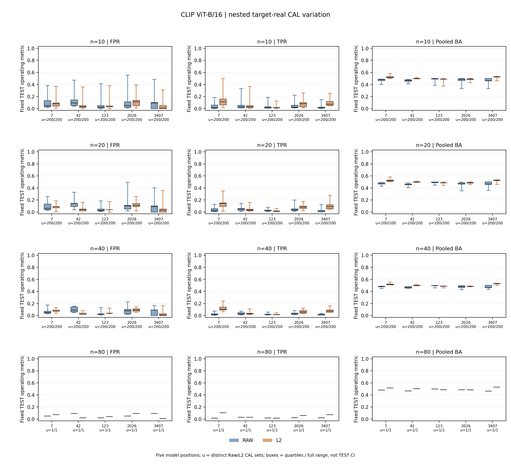
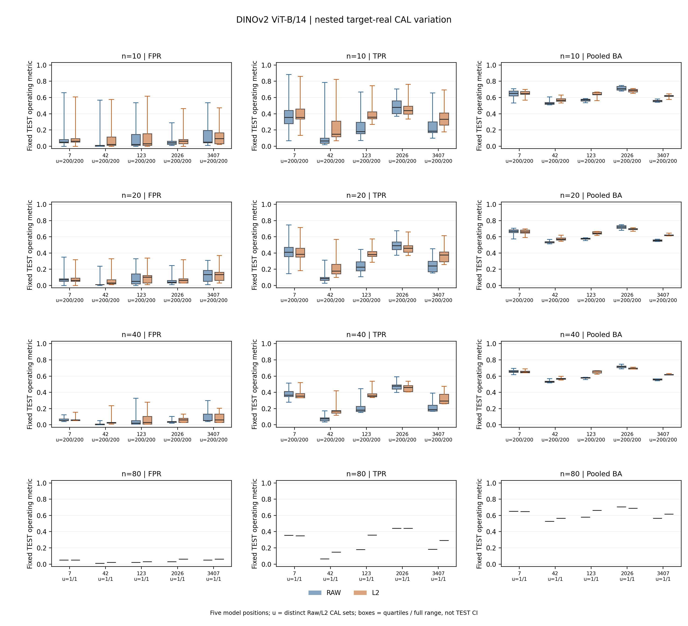
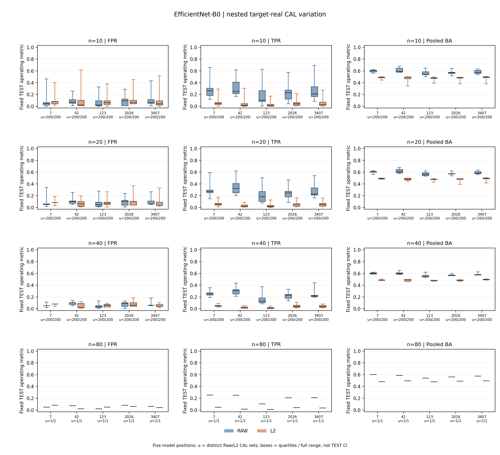

# 已验收 D 图件 / Accepted D figures

本节只包含15个已验收D正式模型的真实输出。三骨干各自保留五训练种子；H比较及完整论文尚待完成。所有图已通过数值、来源哈希与版面核验。 / These are actual outputs of the 15 accepted D formal models, with five training seeds retained within each backbone. H comparisons and the complete manuscripts remain pending. All figures passed numeric, lineage-hash and layout checks.

图注以[论文用修正版中英图注](figures/D_accepted_results_captions_for_paper_cn_en.md)为准。原导出包保留未经覆盖的caption及complete记录用于复现，其EXPORTED_RENDER_REVIEW_PENDING是导出时状态；后续独立验收另存。 / Use the [corrected paper captions](figures/D_accepted_results_captions_for_paper_cn_en.md). The unchanged export packet preserves its original caption and export-time pending receipt; subsequent acceptance is recorded separately.

## 图 D1 / Figure D1 — Source TEST ECDF

正确自然视频分组、固定原头下保存的FP64 mean-logit margin；Raw/L2、真假类别与训练种子分别显示。 / Saved FP64 mean-logit margins under correct natural-video grouping and the fixed original head, separated by Raw/L2, class and training seed.

## 图 D2 / Figure D2 — CDF registered ranking-cohort ECDF

target_full为既定RQ2/3排序队列，并非RQ4 target_test；其成员与CAL和TEST的合法重叠不构成RQ4的CAL/TEST混合。图中不重新抽样、拟合阈值或使用高精度rank_score替代FP64绘图分数。 / The registered target_full ranking cohort for RQ2/3 differs from RQ4 target_test and legitimately overlaps the separately defined roles. RQ4 CAL and TEST remain disjoint. No resampling, threshold fitting or rank-score substitution is performed for this display.

## 图 D3 / Figure D3 — CLIP target-real CAL variation

## 图 D4 / Figure D4 — DINOv2 target-real CAL variation

## 图 D5 / Figure D5 — EfficientNet-B0 target-real CAL variation

图D3–D5在各固定训练模型与固定target_test上展示200次共同嵌套CAL预算10/20/40/80的经验FPR、TPR和pooled BA。箱体为中位数/四分位数/完整范围，不是TEST置信区间或训练种子SD。u标注独特子集数；80预算只有一个独特集合，重复行仍如实保留。 / Figures D3–D5 show empirical FPR, TPR and pooled BA over 200 common nested CAL repetitions at budgets 10/20/40/80 for each fixed model and target_test. Boxes show median, quartiles and the full range, rather than TEST confidence intervals or training-seed SD. u denotes distinct subsets; the n80 budget has one distinct set despite 200 saved repeat rows.

十二张[原字段连接表](figures/D_accepted_results/tables/five_seed_metrics.csv)及逐seed/效应/校准/oracle/数值表保留NA；完整字段路径和SHA见[导出记录](figures/D_accepted_results/complete.json)。可编辑矢量SVG与PNG同名位于图目录。 / Twelve tables retain the original fields and NA cells, including per-seed metrics, effects, calibration, oracle and numerical results. See the [export manifest](figures/D_accepted_results/complete.json) for paths and SHAs; matching SVG assets are available.
