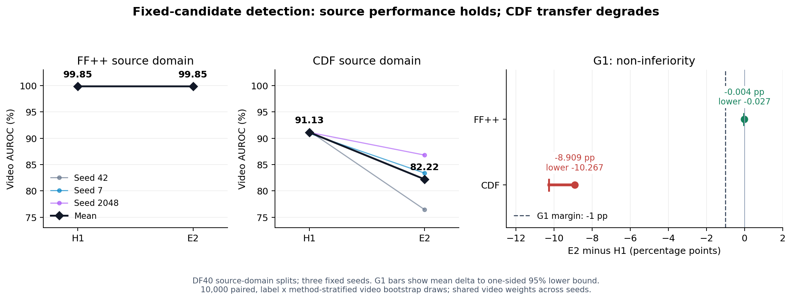

# Deepfake Detection 假设验证汇报

**正式结论：当前 E2-Semantic Visual-Jev 方案不支持（`not_supported`）。** FF++／CDF 两个主域、3 个固定种子、7 种条件共 42 组正式评估已完成。冻结的 10,000 次配对 bootstrap 与 G1–G6 判定显示：仅 G3 通过；G1、G2、G4、G5、G6 均有预注册点门槛未达标。这里的“不支持”针对本次具体模型、训练任务、词库和数据切分，不等于否定所有语义检测方法。

最后核对：2026-09-23 18:30 KST。[完整门槛状态](../results/summary/gate_status.json)、[42 组独立审计](../results/progress/audit_primary_artifacts.json)。

## 数据和比较口径

本文的 FF++／CDF 是 **DF40 中分别以 FaceForensics++／Celeb-DF 为来源域**的测试切分，两域均含相同 16 种伪造方法。它们不是官方原始 FF++／Celeb-DF-v2 benchmark，也不是未见伪造方法测试。每种子 FF++ 有 3,049 个物理视频（真实 140、伪造 2,909），CDF 有 9,901 个（真实 178、伪造 9,723）。总体 AUROC 按物理视频计算，未对方法做宏平均。[数据域审计](../results/progress/dataset_domain_audit.json)核对了索引和覆盖。

H1 是原有固定真假候选的共享评分器；E2 在同一冻结视觉塔上加入问题、可变候选及两层 decoder，并以五类语义任务训练。G1 比较两者在**同一物理视频、帧覆盖和固定真假任务**上的视频 AUROC。三种子取算术均值，既不是模型集成，也不重抽训练种子。训练时约 91% 的 T1–T5 混合验证准确率不能与此视频 AUROC 直接比较。

## 固定真假任务：FF++ 持平，CDF 明显下降

| 来源域 | 种子 | H1 AUROC | E2 AUROC | E2−H1 |
|---|---:|---:|---:|---:|
| FF++ | 42 | 99.8551% | 99.8394% | −0.0157 百分点 |
| FF++ | 7 | 99.8539% | 99.8487% | −0.0052 百分点 |
| FF++ | 2048 | 99.8502% | 99.8581% | +0.0079 百分点 |
| **FF++** | **三种子平均** | **99.8531%** | **99.8487%** | **−0.0043 百分点** |
| CDF | 42 | 91.3479% | 76.4587% | −14.8892 百分点 |
| CDF | 7 | 90.9243% | 83.3891% | −7.5352 百分点 |
| CDF | 2048 | 91.1080% | 86.8063% | −4.3016 百分点 |
| **CDF** | **三种子平均** | **91.1267%** | **82.2181%** | **−8.9087 百分点** |

G1 要求两个域的平均差值及单侧 95% 下界均不低于 −1 百分点。FF++ 下界为 −0.0274 百分点，通过；CDF 下界为 **−10.2672 百分点**，点估计和下界都未通过。bootstrap 按真假标签×方法分层，以 `method_id::video_id` 为物理视频聚类单位；同一轮抽样在两个模型和三个固定种子间共享权重，共 10,000 次。[附表](../results/summary/bootstrap_intervals.csv)保存精确数值。

[矢量图](figures/g1_fixed_candidate_comparison.svg)。方法级事后诊断将每种伪造方法与该域所有真实视频分别比较；CDF 的 48 个“种子×方法”组合中有 44 个 E2 AUROC 下降。它表明总体下降不限于单一方法，但相关拆分没有预注册为独立门槛，也未做多重比较校正。[96 行诊断](../results/progress/fixed_method_diagnostic.csv)及[输入哈希](../results/progress/fixed_method_diagnostic_manifest.json)。

CDF 的视频有 98.2% 为伪造，固定 0.5 阈值下的普通准确率会掩盖真实类表现。三种子平均：

| 来源域 | 模型 | 普通准确率 | 平衡准确率 | 真实类召回 |
|---|---|---:|---:|---:|
| FF++ | H1 | 98.95% | 95.82% | 92.38% |
| FF++ | E2 | 99.07% | 95.21% | 90.95% |
| CDF | H1 | 98.23% | 51.02% | 2.06% |
| CDF | E2 | 98.22% | 51.11% | 2.25% |

因此 CDF 两模型的普通准确率都接近 98%，并不表示能有效识别真实类；排序质量由 AUROC 描述。单种子混淆矩阵及 Brier、AP 等次要指标见[固定任务附表](../results/summary/report_fixed_video_by_seed.csv)和[三种子摘要](../results/summary/report_fixed_video_summary.csv)。

## G1–G6 正式判定

| 门槛 | 状态 | 决定性证据 |
|---|---|---|
| G1 固定真假非劣效 | **失败** | CDF E2−H1 为 −8.9087 百分点，单侧 95% 下界 −10.2672 百分点；要求均 ≥ −1。 |
| G2 未见措辞泛化 | **失败** | FF++ T2/T4/T5 的 seen→heldout 降幅分别为 29.33/22.98/24.84 百分点；每任务至多 5。CDF T4/T5 分别下降 21.79/13.53 百分点。 |
| G3 候选排列稳定性 | **通过** | 两域每种子均审计 57,344 次比较，预测一致率 100%；最大概率误差 FF++ 为 7.45×10⁻⁷、CDF 为 8.34×10⁻⁷，均 ≤ 10⁻⁶。 |
| G4 极性问题一致性 | **失败** | FF++／CDF 的未见 T2 平衡准确率为 66.24%／50.36%（要求 ≥80%）；同视频真假问句一致率为 28.26%／47.22%（要求 ≥95%）。 |
| G5 语义类别与反事实 | **失败** | CDF 未见 T5 宏平衡准确率 37.72%（要求 ≥60%）；CDF T4 为 56.46%（要求 ≥65%）；伪造家族反事实排序仅 46.65%（要求 ≥80%）。FF++ T4 与反事实排序也未达标。 |
| G6 无意义语言控制 | **失败** | CDF 无意义候选 T2/T4/T5 的 meaningful−control 分别为 0.40/6.49/4.95 百分点，无意义问题 T2/T4 为 0.45/6.47 百分点；均低于每项至少 10 百分点的要求。CDF T2 两类控制的双侧 95% 下界还低于 0。 |

G2 的 T1/T3 在 FF++ 几乎不降，但门槛要求每项及宏平均都达标，不能以宏平均代替失败单项。G5 的 FF++ 未见 T5 达标，也不能抵消其他单项。G6 在 FF++ 所列控制项均过阈值；CDF 的部分任务失败已经足以使整项失败。具体每种子值、阈值和置信区间均见[门槛状态](../results/summary/gate_status.json)；五类语义任务的[视频附表](../results/summary/report_semantic_video_summary.csv)和仅供诊断的[帧级附表](../results/summary/report_semantic_frame_summary.csv)不改变门槛判定。

## 完整性与解释边界

三种子 × 两域 × 七条件的 42 组正式 metrics 和所需配套文件全部齐备；独立审计有 108 项通过、0 项错误。三份 `run_provenance.json` 均为四卡、可汇报运行，评估科学源码包 SHA256 同为 `0529ab9127e142d18afef5f0ffd52c2781ff506e449cded116510afd8e3d0af7`。原 seed 42、7 调用曾因默认 600 秒 NCCL 等待上限退出 1，历史记录保留；恢复调用仅把运行时上限调至 3,600 秒，五次调用的真实退出码均为 0，并未覆盖已完成组。[恢复完成记录](../results/evaluation_logs/primary_v2_recovery_20260923T065528Z/completion.json)、[独立审计](../results/progress/audit_primary_artifacts.json)、[附表输入清单](../results/summary/report_tables_manifest.json)。

无意义候选未严格匹配真实候选的文本长度，因此 G6 降幅或缺乏降幅不能单独归因于语义。语义行按视频×语言变体计分，bootstrap 按物理视频聚类；三个固定种子共享冻结视觉编码器，置信区间不覆盖重新训练视觉塔或种子总体的不确定性。E2 同时改变决策网络、训练任务和文字分布，不能从本实验确定哪一改变导致 CDF 退化。测试结果未用于改阈值或选模型。更完整的限制见[协议审计](protocol_audit_zh.md)。
