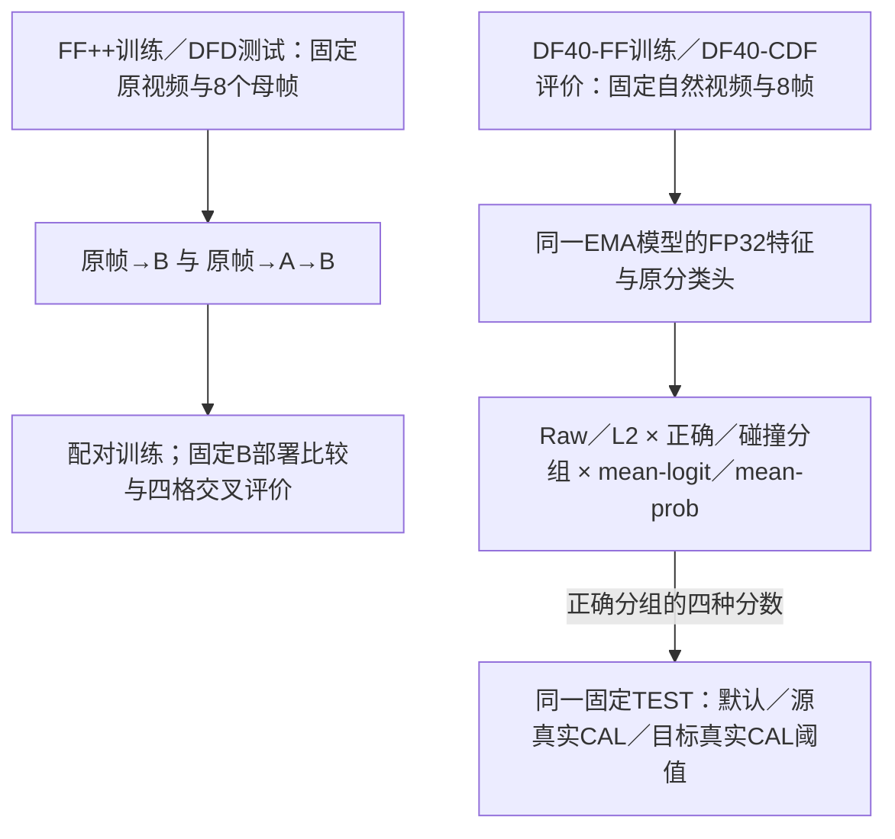
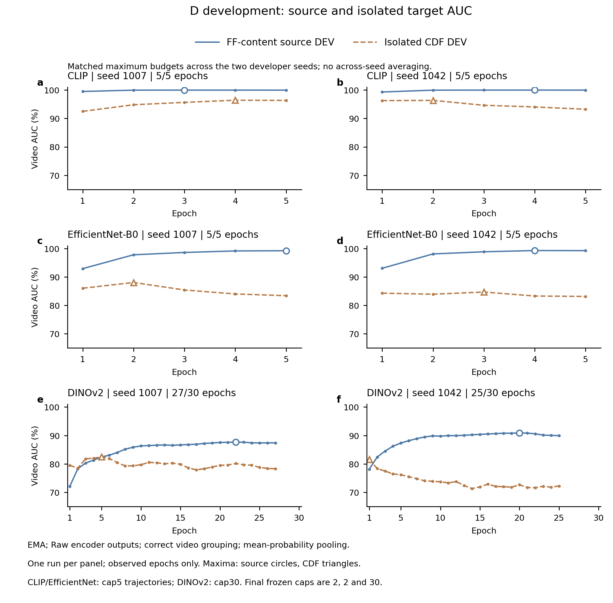
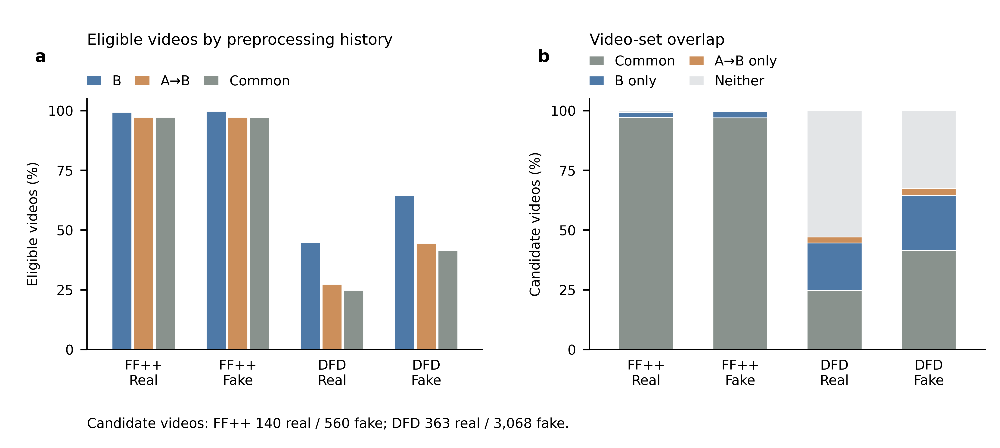
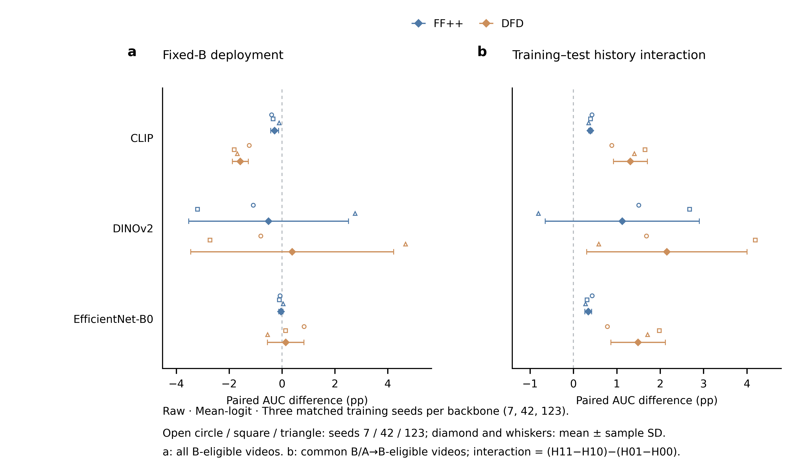
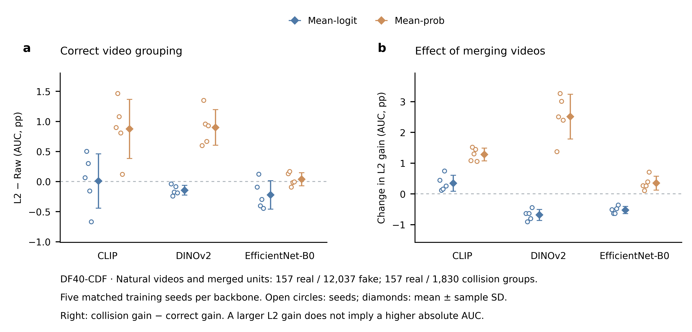
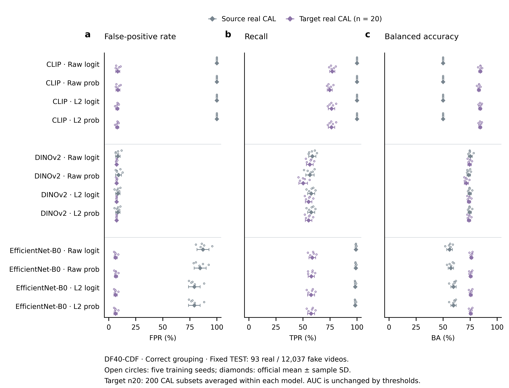

# 深度伪造检测评价中的预处理历史、特征范数、视频聚合与阈值迁移

## 摘要

深度伪造检测的性能比较同时受到图像处理、视频分组、分数聚合和决策阈值的影响，单一AUC变化难以确定改进出现在哪个环节。本研究对三种预训练骨干开展配对实验：在同一模型逐帧输出上构造归一化、分组与聚合的八格对照，并从相同原视频母帧重建两条完整人脸处理历史。结果显示，DINOv2的五个种子在正确分组的mean-logit下均因推理L2而下降，在mean-prob下均提高；错误合并还会使部分种子的归一化优劣结论反转。训练处理历史同样影响固定部署输入：CLIP在DFD上的A→B训练相对B训练平均下降1.58±0.30个百分点，跨骨干性能差距也随测试输入历史改变。排序与部署操作点则明显分离：CLIP在固定CDF TEST上AUC为92.89±1.03%，源真实校准阈值的误报率仍达100%；20个目标真实视频校准后BA为84.39±1.37%。这些受控对照将模型的推理干预与评价流程变化逐项对应，为可复核的跨域检测方法比较提供了完整管线依据。

**关键词：** 深度伪造检测；跨域评价；预处理历史；特征范数；视频聚合；阈值迁移。

## 1. 研究问题

深度伪造检测的性能比较同时依赖图像输入、模型输出和评价规则。[DeepfakeBench](https://proceedings.neurips.cc/paper_files/paper/2023/hash/0e735e4b4f07de483cbe250130992726-Abstract-Datasets_and_Benchmarks.html)以统一的数据管理和评价流程促进公平比较；[DF40](https://arxiv.org/abs/2406.13495)进一步提供多种伪造技术及跨内容域数据。对于具体实验，还需要区分性能差异出现在哪个环节：二次人脸处理是否改变输入分布，特征去范数是否改变固定分类头的排序，不同视频是否被合并，以及阈值是否适用于新的真实视频分布。

本研究通过配对对照分别考察上述四个问题。预处理实验在同一原视频及采样帧上构造两种完整处理历史，控制模型初始化、抽样和训练设置；评分实验保存同一模型的逐帧特征与原分类头，再改变推理归一化、视频分组及聚合函数。阈值实验固定模型、分数和测试视频，仅改变校准数据来源。这样的设计使每项比较对应明确的干预变量。

本文将比较落实为四个可检验问题：

1. **RQ1：预处理历史。** 在相同B部署输入上，B与A→B训练的模型是否表现不同；切换测试处理历史后，这种差异及跨骨干性能差距如何变化？
2. **RQ2：推理去范数。** 固定原分类头时，L2的跨域AUC效应是否依赖mean-logit或mean-prob聚合，以及比较基线？
3. **RQ3：视频评价单位。** 跨方法合并同名视频是否改变L2的相对增益，乃至使同一种子的评价结论反转？
4. **RQ4：阈值迁移。** 源真实视频校准的阈值迁移后产生多少误报与漏检；少量独立目标真实视频校准如何改变FPR、TPR与BA？

## 2. 方法

### 2.1 实验结构

两条实验路线使用不同训练数据。评分实验使用DF40发布图像中的21方法子集，在FF++来源数据上训练，在CDF来源数据上跨域评价。本文将二者分别记为DF40-FF和DF40-CDF；DF40-CDF指CDF来源的21方法生成数据。预处理实验使用FF++ c23完整视频及DeepFakeDetection（DFD）原视频，通过独立的人脸处理重建输入，FF++用于训练和源域评价，DFD用于跨域评价。[数据与压缩格式说明](https://github.com/ondyari/FaceForensics/blob/master/dataset/README.md)

评分实验以CLIP、DINOv2和EfficientNet-B0为骨干，各使用5个正式训练种子。预处理实验首先以EfficientNet-B0完成3个种子的两历史配对对照；根据预先设定的条件，向CLIP和DINOv2扩展同样的3种子配对设计。扩展采用相同的冻结视频和母帧。

### 2.2 模型与训练

各模型采用公开预训练视觉编码器和新增的二输出线性分类头，以交叉熵进行全参数微调。CLIP采用[ViT-B/16](https://proceedings.mlr.press/v139/radford21a.html)，DINOv2采用官方[无register的ViT-B/14](https://github.com/facebookresearch/dinov2)，卷积骨干采用ImageNet预训练的[EfficientNet-B0](https://proceedings.mlr.press/v97/tan19a.html)。输出特征维度分别为512、768和1280，学习率分别为1×10⁻⁵、5×10⁻⁵和1×10⁻⁴。

共同训练设置为AdamW、权重衰减5×10⁻⁴、实际batch size 128、FP16混合精度及最大范数1.0的梯度裁剪。各模型在单张V100 32GB上独立训练，最多4项并行，CPU处理和统计分析与训练并行。采用epoch级调度，warmup设为1轮，随后余弦衰减；该配置首轮即达到初始学习率。训练阶段不增加输出特征L2归一化，保留骨干原生LayerNorm或BatchNorm。

图像统一输入224×224，训练增强沿用固定版本的[DF40代码](https://github.com/YZY-stack/DF40/tree/ce808160e0df31544b41c7b60b942849ba88bca8)：水平翻转、±10°旋转、3—7核高斯模糊、颜色扰动及质量40—100的JPEG压缩，相应随机增强模块的应用概率为0.5，并保留其等比例缩放步骤。输入标准化分别匹配各公开预训练骨干。测试不使用随机增强。

指数移动平均（EMA）衰减为0.999，在成功参数更新后更新EMA参数，缓冲量使用当前模型值。每轮用EMA权重计算源验证集正确视频分组下的mean-prob AUC，以源验证AUC选择测试权重；除本轮H-DINOv2和H-EfficientNet固定训满10轮外，正式训练使用连续5轮不改善的早停规则。

初始训练预算由独立开发种子1007、1042开发，H本轮十轮修订单独记录，正式评分实验使用7、42、123、2026、3407，预处理实验使用7、42、123。评分实验开发阶段允许观察源验证及隔离的CDF开发集；比较候选预算时，使用各预算下由源验证选出的EMA在CDF开发集上的表现。改变总预算后，从相同公开预训练权重重新训练确认。

评分路线CLIP和EfficientNet-B0经实际2轮与5轮双种子对照，将正式最大预算固定为2轮。DINOv2两个开发运行分别在27/25轮联合早停，源选最佳为22/20轮，保留30轮最大预算。其平均CDF开发曲线的最高点位于第1轮；此时源验证AUC平均为75.10%，两个源选最佳checkpoint的源验证AUC平均为89.28%。DINOv2预算结合源任务学习进程与早停确定；正式checkpoint在预算内仍只由源验证选择，而不固定使用第30轮权重。

预处理路线三个骨干最大预算统一为10轮。CLIP保留原十轮模型；本轮将DINOv2及EfficientNet-B0分别从公开预训练重新训满10轮，学习率5×10⁻⁵和10⁻⁴、batch128及其余训练设置不变，余弦调度按10轮总预算重新计算。预算内仍用共同源DEV-B选最佳EMA，两历史共享选点；seed7/42/123选点为DINOv2：10/10/10轮；EfficientNet-B0：10/10/10轮，十二个新模型实际均完成10轮。本修订发生在观察初版H目标结果之后，明确记录这一时间顺序；十轮轨迹不逐轮评价DFD，不依据DFD重新选checkpoint。旧长预算产物保留于历史归档，当前主结果全部使用上述新模型。

**图1｜源验证与隔离CDF开发集的逐轮AUC。** 三列为CLIP、EfficientNet-B0、DINOv2，两行为开发种子1007、1042。使用EMA、Raw、正确视频身份和mean-prob；源数据为DF40-FF，目标为隔离的DF40-CDF开发集。每条轨迹保留实际完成轮数。DINOv2的源最佳为22/20轮，CDF最佳为5/1轮；其余预算确认曲线另附。图中没有正式TEST逐轮选点。

D路线每epoch包含799个训练batch，H路线每模型每epoch包含185个训练batch；因此CLIP最大2轮与10轮分别对应最多1,598与1,850次更新尝试。轮数按各自数据与调度开发，实际成功更新次数另受早停和AMP跳步影响。

### 2.3 评分实验的数据与抽样

21种方法包含9种人脸交换方法：fsgan、faceswap、simswap、inswap、blendface、uniface、mobileswap、e4s、facedancer；以及12种人脸重演方法：fomm、facevid2vid、wav2lip、MRAA、one_shot_free、pirender、tpsm、lia、danet、sadtalker、mcnet、hyperreenact。使用发布图像和官方索引，不在评分实验中再次检测或裁剪人脸。

FF++官方训练来源对被固定分为306对训练和54对开发，官方验证划分的真实视频用于源阈值校准，官方测试划分用于源测试。关联、重复与固定帧资格检查后的数量如下。

| 角色 | 真实视频 | 伪造视频 |
|---|---:|---:|
|DF40-FF训练|611|12,232|
|DF40-FF开发|108|2,175|
|DF40-FF源CAL|140|0|
|DF40-FF测试|140|2,884|
|DF40-CDF开发|20|420|
|DF40-CDF排序评价|157|12,037|
|DF40-CDF目标CAL|64|0|
|DF40-CDF阈值TEST|93|12,037|

每个合格自然视频固定8张不同RGB帧，评价时遍历全部8帧。训练保留102,744条帧关联贡献，精确相同RGB合并为102,225个输入，重复输入的抽样质量相加。真实类别的总抽样质量为0.5，各伪造方法为0.5/21；方法内按视频及帧分配质量。每轮有放回抽样102,272次，即799个实际batch。方法平衡指期望质量平衡，随机抽样的实际次数可以不同。

CDF开发集每种伪造方法20个视频，并有20个真实视频。数据隔离先于模型预测，关系定义包含已知来源、全候选精确RGB重复、跨方法同名及保守身份名称代理的传递闭包。开发集及其关联视频共隔离890个候选，包含450个未用于开发打分的关联视频；它们不进入正式排序队列、阈值校准或阈值TEST。开发集与三个正式目标角色的视频、关系组及RGB交集均为零，目标CAL与阈值TEST同样隔离。排序评价保留157个真实视频，其中包含64个CAL真实视频；阈值实验使用另列的93个TEST真实视频。

### 2.4 完整预处理历史与交叉测试

预处理实验采用[FF++](https://arxiv.org/abs/1901.08971)的1,000个真实视频与Deepfakes、Face2Face、FaceSwap、NeuralTextures四方法各1,000个伪造视频，DFD包含363个真实和3,068个伪造视频。从每个原视频的32个固定时间候选位置确定8个不同RGB母帧，记录实际帧序号与时间戳，再执行人脸处理。几何处理失败不触发换帧。

管线A使用[RetinaFace](https://arxiv.org/abs/1905.00641)的5点关键点对齐裁剪为336×336。具体实现为[biubug6/Pytorch_Retinaface](https://github.com/biubug6/Pytorch_Retinaface/tree/b984b4b775b2c4dced95c1eadd195a5c7d32a60b)，采用MobileNet0.25和公开权重，检测最长边1024、分数阈值0.6、NMS IoU阈值0.4，以固定ArcFace112五点模板放大3倍计算保持方向的最小二乘相似变换。

管线B使用[dlib HOG/SVM检测器及68点预测器](https://dlib.net/face_landmark_detection.py.html)，检测最长边1024并上采样1次。根据dlib的`get_face_chip_details`规则计算size=224、padding=0.25的对齐几何，再以OpenCV双三次插值生成224×224图像。存在多张人脸时按固定面积、分数和坐标规则选择人脸。图像采用零填充，另以最近邻插值保存有效区域mask；分类器输入为RGB图像。

两种数据历史分别为原始帧→B和原始帧→A→B。后者保存并读回A生成的PNG及mask，再完整执行B的检测、68点定位和对齐裁剪，继承A的有效区域。两历史使用同一组原始母帧；每个合格视频要求8帧全部成功，并有8张不同最终RGB图像。处理后的图像、变换、mask和失败原因均保留。

训练和开发使用两历史共同成功的视频，分别为2,951个训练视频（590真、2,361假）和525个开发视频（106真、419假）。两个模型共享公开初始化、随机种子、母帧抽样与增强键，并同步配对更新中的模型随机操作。真实抽样质量0.5，四伪造方法各0.125，每轮23,680次抽样，即185个实际batch。以两个模型在同一B源验证队列上的mean-prob AUC均值选择共同epoch，两模型均加载该epoch的EMA。

令M1在B数据上训练，M2在A→B数据上训练，交叉评价定义如下。

| 训练历史 | B测试输入 | A→B测试输入 |
|---|---|---|
|M1：B|H00|H01|
|M2：A→B|H10|H11|

主部署比较在相同的全部B成功测试视频上计算H10−H00。四格比较另在B与A→B共同成功队列上计算，预处理交互为I_H=(H11−H10)−(H01−H00)。该交互衡量测试输入历史的效果是否随训练历史改变。

| 测试域 | 原始候选真/假 | B成功真/假 | 共同成功真/假 | B覆盖 | 共同覆盖 |
|---|---|---|---|---:|---:|
|FF++|140/560|139/558|136/543|99.57%|97.00%|
|DFD|363/3,068|162/1,977|90/1,271|62.34%|39.67%|

主部署差和四格交互使用各自固定队列，不跨队列相减。AUC对应相应预处理成功子集，同时报告原始候选分母及处理覆盖。初始EfficientNet结果用于触发预先约定的骨干扩展；H-DINOv2/EfficientNet十轮预算修订的时间顺序见2.2节。预算内源选点及H阈值校准不使用DFD。

扩展后的跨骨干分析在相同队列、相同训练种子及各自注册配方下比较AUC差距；分别保留全部B队列的训练历史变化与共同队列的测试输入变化，记录点估计顺序是否反转。该分析属于条件扩展后的探索性对照，报告全部骨干对、两聚合及三个种子，不按跨骨干比较的优劣另调各模型；十轮预算修订的时间顺序见2.2节。

### 2.5 特征去范数、聚合函数与评价单位

令编码器输出h，原二输出线性头为W和b。先将原FP32头提升到FP64，再计算w=W₁−W₀、β=b₁−b₀。Raw与L2逐帧margin分别为

\[
z_{\mathrm{Raw}}=w^\top h+\beta,\qquad
z_{\mathrm{L2}}=w^\top\frac{h}{\max(\lVert h\rVert_2,10^{-12})}+\beta.
\]

网络以FP32导出特征，评价在相同特征缓存和原分类头上产生两套逐帧分数。推理L2只移除额外的输出半径，分类头保持固定；该比较针对既有分类器的推理干预。

对视频帧集合V，mean-logit与mean-prob分别定义为

\[
S_{\mathrm{logit}}(V)=\frac{1}{|V|}\sum_{i\in V}z_i,\qquad
S_{\mathrm{prob}}(V)=\frac{1}{|V|}\sum_{i\in V}\sigma(z_i).
\]

其中σ为Sigmoid。两种聚合的先后顺序不同；σ(S_logit)在精确算术中与S_logit保序，而S_prob通常不与它们等价。数值分析分别检查公共正尺度、公共半径、Jensen差、帧间方差、概率端点、并列及排序配对，必要时采用更高精度复核饱和附近的排序。

正确分组保留域、标签、伪造方法和自然视频标识。碰撞分组删除伪造方法，只保留同域、同标签的video_id，将k个方法视频的全部8k帧合并平均，真实视频计一次；不在合并池内重新抽8帧。因此形成分组×归一化×聚合的八格对照。源测试的正确伪造单位为2,884个，碰撞后为280组；DF40-CDF排序队列对应12,037个和1,830组，真实单位仍为140和157个。

对每种聚合分别计算Δ_correct=AUC(L2,correct)−AUC(Raw,correct)、Δ_collision=AUC(L2,collision)−AUC(Raw,collision)，以及I_G=Δ_collision−Δ_correct。重点记录Δ_correct<0且Δ_collision>0的方向反转种子；正交互与方向反转分开报告。碰撞改变评价单位和权重，八格比较用于检验评价结论对分组规则的敏感性。

辅助分析分别量化聚合基线与分组操作。记L_R=AUC(Raw,mean-logit)−AUC(Raw,mean-prob)、L_L=AUC(L2,mean-logit)−AUC(L2,mean-prob)，则同模型、同分组内满足Δ_prob−Δ_logit=L_R−L_L。分组分解另定义自然视频等权、组等权但保留成员分数、成员数加权的组均分、组等权的组均分四种状态；对改变权重和替换组均分的两种次序取平均贡献。原正确及碰撞AUC、全部成员和排序配对credit须重建，分解用保存的高精度排序分数与精确有理数计算，不解释为训练因果效应。

### 2.6 阈值迁移与统计

阈值实验固定正确分组的同一测试队列，对Raw/L2与两种聚合形成的四种分数分别比较默认、源真实CAL和目标真实CAL阈值。默认阈值为mean-logit的0、mean-prob的0.5。校准阈值是满足对应真实CAL经验FPR≤5%的最小可行值，score≥阈值判为伪造；按固定规则处理并列和边界。校准后的判定使用保存的FP64分数空间；用于恢复饱和附近排序的高精度复算不改变这些固定精度操作点。

目标真实CAL主预算为20，另报告10、40；从64个视频中进行200次共享、嵌套子集抽样。80视频预算不可用。所有校准方式评价同一93真、12,037假的固定TEST，报告误报率FPR、召回率TPR、平衡准确率BA=(TPR+1−FPR)/2，以及FP、TP数量和21种伪造方法各自的TPR。方法级计数须准确还原整体FP、TP及可用宏平均指标；目标校准先在单个模型内汇总200个子集，再计算五个训练种子的均值与样本标准差。不可用预算保留NA。更换阈值不改变同一分数的AUC。H交叉测试的附加阈值评价使用各模型的139个B源CAL真实视频，并将同一阈值用于B和A→B输入。

评分实验报告五训练种子、预处理实验报告三训练种子的逐种子结果及均值±样本标准差。所有方法差先在同一训练种子内配对。正确分组同时报告pooled AUC与21方法等权macro AUC；跨方法碰撞组不赋予单一方法标签。

条件组bootstrap使用2,000次共享抽样构造逐比较95%百分位区间，分组比较采用来源关系与碰撞关系的联合闭包。报告门槛为至少20个组且最大组不超过队列自然视频的一半，并另查各类别及方法至少20个关系组；不满足相应条件则区间记NA。DF40-CDF伪造队列为1个联合关系组；DFD全部B的真实/伪造关系组为12/16，共同队列为10/13，相应目标区间不可用。AUC点估计、训练种子标准差、校准子集波动与可用的条件测试组区间分别报告。

“仅真实校准”描述阈值确定阶段。评分实验的预算开发使用过独立CDF开发集的真、假标签，属于使用目标开发信息的模型选择；阈值TEST与CDF开发集始终隔离。

## 3. 结果

### 3.1 完整管线改变可评价队列与图像覆盖

在相同原始候选和固定母帧上，DFD的B管线保留162/363个真实与1,977/3,068个伪造视频，覆盖率分别44.63%和64.44%；A→B保留99个真实和1,362个伪造，分别27.27%和44.39%。两者共同保留90个真实和1,271个伪造，分别24.79%和41.43%。B独有778个视频，A→B独有100个，因此完整处理历史会改变可评价队列的成员。四格分析使用共同集合；固定B部署比较使用全部B成功集合。

资格判定要求8张预先固定的母帧均成功且最终RGB不同；6个DFD伪造视频因不同母帧不足而退出，处理失败不补帧。逐帧记录显示，DFD真实视频原帧B有410/2,904个母帧失败，8帧联合资格下201/363个视频不合格，说明单帧成功率和视频覆盖率对应不同的评价单位。

保存的有效性mask还显示，共同FF++源测试队列的平均无效区域由B的0.0777%变为A→B的10.3214%；DFD共同队列分别为0.3089%与10.0159%。mask只用于审计，分类器输入仅RGB。这些几何描述支持将干预解释为完整管线历史，性能效应由后续配对模型对照评价。

**图2｜完整预处理历史改变视频覆盖与队列成员。** a，FF++源测试与DFD各类别在B、A→B及共同集合上的视频资格比例；分母为同一冻结原视频队列。b，同一候选队列按两管线共同成功、仅B成功、仅A→B成功和均失败分解。资格要求8张固定母帧全部成功，不补帧。图中为完整候选计数，无抽样误差条。

### 3.2 训练历史与测试处理共同影响检测性能和模型比较

相同B部署输入下，训练处理历史的影响随骨干变化。CLIP在DFD的H10−H00为-1.5801±0.3008个百分点，三个种子均下降；本轮十轮重跑的EfficientNet-B0为+0.1382±0.6913，2正1负；DINOv2为+0.3814±3.8402，1正2负。下表使用Raw推理和mean-logit聚合；±为三个配对训练种子的样本标准差。

|骨干|测试域|M1→B AUC，%|M2→B AUC，%|配对差H10−H00，百分点|
|---|---|---|---|---|
|CLIP|FF++|99.2913±0.1464|99.0103±0.0356|-0.2811±0.1477|
|CLIP|DFD|97.1275±0.7723|95.5474±0.9994|-1.5801±0.3008|
|DINOv2|FF++|66.1888±2.9850|65.6782±0.7552|-0.5106±3.0224|
|DINOv2|DFD|61.7020±4.6237|62.0834±1.0222|+0.3814±3.8402|
|EfficientNet-B0|FF++|98.0532±0.0907|98.0089±0.0250|-0.0443±0.0775|
|EfficientNet-B0|DFD|93.6670±0.6867|93.8052±0.9253|+0.1382±0.6913|

在相同共同成功的DFD队列上进行四格测试，得到以下结果。四格AUC单位为%，差值单位为百分点；每项差值均先在同一种子内计算。

|骨干|H00：M1→B|H01：M1→A→B|H10：M2→B|H11：M2→A→B|
|---|---|---|---|---|
|CLIP|97.7364±0.7144|98.1394±0.6310|96.3630±0.8924|98.0782±0.6571|
|DINOv2|65.9810±3.8442|63.9147±2.0752|67.4287±1.6103|67.5146±1.5401|
|EfficientNet-B0|95.3510±0.5463|93.8520±0.5013|95.5850±0.7364|95.5762±0.3834|

|骨干|M1输入切换，百分点|M2输入切换，百分点|四格交互，百分点|交互正/负种子|
|---|---|---|---|---|
|CLIP|+0.4030±0.1204|+1.7152±0.5063|+1.3122±0.3898|3/0|
|DINOv2|-2.0663±1.9209|+0.0860±0.1081|+2.1523±1.8494|3/0|
|EfficientNet-B0|-1.4990±0.3244|-0.0087±0.4545|+1.4902±0.6281|3/0|

mean-prob的平均交互分别为CLIP +0.9811±0.3580、DINOv2 +2.1438±1.8647、EfficientNet-B0 +1.5185±0.5911个百分点，相应正/负种子为3/0、3/0、3/0。输入历史效应与交互须保留骨干、种子和聚合条件。

固定保留原指定的跨骨干对照：同为A→B训练的seed123模型，在同一90真/1,271假DFD共同视频上，CLIP在B/A→B输入的AUC为95.4507%/97.3241%，EfficientNet-B0为95.3842%/95.2636%。CLIP减EfficientNet的差从+0.0664变为+2.0605个百分点；该指定M2比较三个种子中有0个严格点估计反转。全部108项逐种子对照共有0项严格点估计反转，完整家族全部保留。比较始终使用同一队列和注册配方，不作为架构单因子效应。

**图3｜完整训练历史改变固定部署性能及对测试输入变化的响应。** a，全部B成功队列上的H10−H00。b，共同成功队列上的(H11−H10)−(H01−H00)。M1为B训练、M2为A→B训练；采用Raw推理和mean-logit。种子7、42、123分别显示；菱形与误差条为配对差均值±样本标准差。三个骨干训练上限均为十轮；DINOv2和EfficientNet为本轮重训结果，两面板分别保留自己的固定队列。

### 3.3 推理去范数的评价依赖聚合基线与视频分组

在DF40-CDF正确分组下，CLIP的mean-logit平均L2效应接近零；DINOv2与EfficientNet-B0的平均效应为负。改用mean-prob后，三个平均效应均为正，但种子一致性不同：CLIP与DINOv2均为5正0负，EfficientNet-B0为2正3负。DINOv2的五个种子在mean-logit下均下降、在mean-prob下均提高，说明即使视频身份正确，聚合规则也足以改变固定头下的L2评价方向。完整八格AUC如下，±为五个训练种子的样本标准差。

| 骨干 | 分组 | 聚合 | Raw AUC，% | L2 AUC，% | L2−Raw，百分点 |
|---|---|---|---|---|---|
| CLIP | 正确 | mean-logit | 92.3864±0.9960 | 92.3944±1.0555 | +0.0080±0.4522 |
| CLIP | 正确 | mean-prob | 91.5098±0.9230 | 92.3840±1.0532 | +0.8742±0.4905 |
| CLIP | 错误合并 | mean-logit | 82.1421±1.3686 | 82.4942±1.5205 | +0.3521±0.4326 |
| CLIP | 错误合并 | mean-prob | 80.3321±1.4079 | 82.4873±1.5214 | +2.1552±0.6574 |
| DINOv2 | 正确 | mean-logit | 83.1673±1.4779 | 83.0218±1.4983 | -0.1455±0.0813 |
| DINOv2 | 正确 | mean-prob | 82.1168±1.5947 | 83.0163±1.4989 | +0.8996±0.2964 |
| DINOv2 | 错误合并 | mean-logit | 73.0197±2.1981 | 72.1873±2.1307 | -0.8323±0.2043 |
| DINOv2 | 错误合并 | mean-prob | 68.7556±1.7740 | 72.1652±2.1312 | +3.4096±0.8668 |
| EfficientNet-B0 | 正确 | mean-logit | 86.2212±0.8871 | 85.9980±0.9630 | -0.2233±0.2362 |
| EfficientNet-B0 | 正确 | mean-prob | 85.9589±0.9338 | 85.9960±0.9641 | +0.0371±0.1085 |
| EfficientNet-B0 | 错误合并 | mean-logit | 75.2114±0.5174 | 74.4609±0.5067 | -0.7505±0.2040 |
| EfficientNet-B0 | 错误合并 | mean-prob | 74.0654±0.6871 | 74.4497±0.5103 | +0.3843±0.2011 |

错误合并降低了三个骨干Raw与L2的绝对AUC，同时扩大了mean-prob下的L2相对增益。按“正确Δ<0且错误Δ>0”定义，CDF中CLIP的mean-logit为1/5个种子反转，EfficientNet-B0的mean-prob为3/5；DINOv2两种聚合均为0/5。EfficientNet-B0的mean-logit另有1/5个种子发生相反方向反转。CDF六个“骨干×聚合”的五种子均值均未发生正确负、错误正的方向反转。源域结果另列于Source Data，与上述跨域结论分别报告。

以Raw mean-logit作为共同参照，正确分组下L2 mean-prob的配对AUC差分别为CLIP -0.0025±0.4511、DINOv2 -0.1509±0.0831、EfficientNet-B0 -0.2252±0.2374个百分点。各自相对Raw mean-prob的正增益，需要结合Raw与L2各自的聚合损失解释。15个模型的聚合恒等式和120个配对排序账本均重建原始AUC，360项数值负对照保序。分组分解另以精确排序credit将交互拆为权重与组内平均的对称贡献，全部120格及60个交互可还原原分数评价；其完整数值保留于补充数据。

**图4｜跨域推理L2效应依赖聚合函数和视频评价单位。** a，正确自然视频分组下的L2−Raw AUC。b，错误合并下的L2增益减正确分组增益。空心圆为五个正式训练种子，菱形及误差线为配对差的均值±样本标准差；不表示目标视频置信区间。正交互不自动意味着方向反转。所有比较共享逐帧预测，错误组保留全部8k帧；两分组分别含157真/12,037假自然视频和157真/1,830假碰撞组。源TEST同构图及全部绝对AUC保留于Source Data。

### 3.4 排序能力与阈值迁移表现分离

CLIP的源真实CAL阈值迁移到CDF固定TEST后，四种评分流程在五个种子上均将全部视频判为伪造，FPR、TPR均为100%，BA为50%。这与相同TEST上较高的AUC同时出现。EfficientNet-B0的源阈值同样产生较高误报；DINOv2则表现出较低误报与较低召回并存。下表以Raw mean-logit列出三骨干的直接对照，始终使用93真、12,037假同一TEST；±为五个训练种子的样本标准差。

| 骨干 | 阈值来源 | 同TEST AUC，% | FPR，% | TPR，% | BA，% |
|---|---|---|---|---|---|
| CLIP | 源真实CAL | 92.8921±1.0313 | 100.0000±0.0000 | 100.0000±0.0000 | 50.0000±0.0000 |
| CLIP | 目标20真实CAL | 92.8921±1.0313 | 8.3333±1.9112 | 77.1127±2.4273 | 84.3897±1.3650 |
| DINOv2 | 源真实CAL | 84.2911±1.3927 | 8.3871±2.2036 | 58.6641±3.3408 | 75.1385±1.8493 |
| DINOv2 | 目标20真实CAL | 84.2911±1.3927 | 7.2957±0.4982 | 56.2656±3.1649 | 74.4850±1.5989 |
| EfficientNet-B0 | 源真实CAL | 87.0721±0.9020 | 87.0968±5.5353 | 99.0214±0.3731 | 55.9623±2.5821 |
| EfficientNet-B0 | 目标20真实CAL | 87.0721±0.9020 | 6.3688±1.4775 | 58.6404±3.0616 | 76.1358±1.2080 |

目标20真实视频校准提高了CLIP和EfficientNet-B0四种评分流程的平均BA，DINOv2四种流程的平均BA均下降。Raw mean-logit的目标减源BA差分别为CLIP +34.3897±1.3650、DINOv2 -0.6536±0.9560、EfficientNet-B0 +20.1735±3.5265个百分点。DINOv2的误报下降伴随召回下降，不能由FPR单项判断校准收益。

200个校准子集先在每个模型内平均，再对五个训练模型汇总；它们不构成额外训练重复。阈值变化未改变视频分数或AUC。默认阈值、目标预算10/40、不可用80的NA及21方法TPR/BA均保留；每个模型2,408个有效操作点已独立还原FP/TP。目标真实CAL的有限样本操作点不构成总体5%误报保证。

**图5｜源真实与目标真实校准的误报、召回和平衡准确率。** a，FPR；b，TPR；c，BA。三个骨干各保留Raw/L2与mean-logit/mean-prob四种分数。空心圆为五个正式训练种子，菱形和误差线为模型均值±样本标准差；目标n20的200个校准子集已先在各模型内平均。两种校准使用相同正确视频分组及固定TEST，改变阈值不改变AUC。全部预算与默认阈值见Source Data。

## 4. 讨论

固定模型与逐帧预测的配对比较表明，检测性能的解释需要同时指定输入处理历史、视频评价单位、聚合函数和决策阈值。这四个环节分别影响可评价的图像与视频、类别内部的权重、视频分数排序和最终判定。将它们分开操纵，可以把“模型改变了什么”与“评价规则改变了什么”逐项对应。这一设计在[DeepfakeBench](https://proceedings.neurips.cc/paper_files/paper/2023/hash/0e735e4b4f07de483cbe250130992726-Abstract-Datasets_and_Benchmarks.html)的统一评价框架和[DF40](https://arxiv.org/abs/2406.13495)的多方法数据基础上，进一步明确了具体性能比较所需固定的条件。

推理L2的效应应结合原分类头与聚合基线解释。分类头在Raw特征上训练，推理时将每帧特征除以其自身范数，同时改变了原头所接收的幅度以及各帧经过Sigmoid后的相对作用。因此，固定头下的L2对照评价的是既有分类器的推理干预，归一化表示配合重新拟合分类头的能力则是另一个问题。三个骨干在mean-prob基线下的平均正增益，连同共同Raw mean-logit基线对照，说明聚合函数是解释该增益所必需的条件；EfficientNet-B0的种子方向不一致，也表明平均正差不等于稳定改善。AUC恒等式和排序配对账本量化了这一条件的作用，但并不将非线性、帧权重变化及数值端点合并为单一的“Sigmoid饱和机制”。

跨方法同名视频的合并同时改变视频分数与伪造类别内部的权重。AUC可以写成真实—伪造视频对的排序credit平均；将若干方法视频合并后，原来的多个比较单位被一个组均分取代，大小不同的组又获得相同权重。因此，视频数量更接近真实类别本身并不是AUC变化的解释，改变的是参与排序的分数分布及其质量分配。本研究的对称分解逐项重建了这两个变化。即使Raw与L2的绝对AUC均降低，二者的差值仍可扩大或发生种子级反转。这一结果也要求分别报告绝对AUC、L2配对差和反转频率，并使用包含伪造方法的自然视频标识。

AUC与阈值操作性能回答不同问题。从定义上看，给同一队列的全部分数施加共同正仿射变换会保持AUC，但固定数值阈值的误报率和召回率可以改变；该性质说明排序保持并不保证阈值迁移。CLIP的同TEST高AUC与源校准后全部判假的结果提供了实际例子。目标真实样本校准可以重新确定操作点，其收益取决于原源阈值与目标真实分布的关系，以及召回随阈值变化的程度。DINOv2的误报—召回权衡说明，仅报告误报下降不足以判断部署收益。本文“真实样本校准”的含义限于阈值阶段；评分预算的开发曾使用隔离CDF开发集的真、假标签。

二次预处理的解释同样需要保留完整历史。最终输入尺寸相同，并不意味着模型看到的内容分布相同：A之后重新执行B会改变检测定位、几何变换、可见内容和无效区域，也会改变哪些视频进入成功队列。M1与M2在同一全部B测试输入上的对照识别训练历史对固定部署输入的影响；共同成功队列中的四格对照进一步识别输入处理变化与训练历史的交互。两种对照承担不同职责，不能跨队列相减。跨骨干配对量化了同一测试输入切换引起的性能差距变化；本轮目标域输入切换比较未出现严格排名反转。这里比较的是各自注册训练配方和公开初始化，H-DINOv2在本轮十轮配方下B训练的源测试AUC为66.1888%，不把骨干差距解释为架构单因子效应。本文检验的是两条完整管线的总效应；若要区分检测器、关键点规则、裁剪范围或中间分辨率各自的贡献，需要另外固定其他环节逐项操纵。

这些结论的统计范围由固定视频、来源关联和训练种子共同限定。训练种子标准差描述同一冻结队列上的训练波动，200个校准子集描述同一真实CAL池的阈值波动，两者都不替代独立来源视频的总体不确定性。关系闭包过大或独立组不足时，保留AUC点估计而不构造不可靠的组bootstrap区间，可以使描述性结论与总体推断保持区分。预处理比较还条件于相应成功队列，因此完整报告候选分母和处理失败率，是把这些配对结果用于后续检测方法比较的必要信息。

## 5. 结论

本研究通过固定母帧、固定模型预测与固定测试队列的配对设计，建立了预处理历史、推理去范数、视频评价单位和阈值迁移之间的可追溯证据链。推理L2的相对收益随聚合基线改变，错误分组能够扩大该收益或使个别种子反转；完整处理历史也会改变相同部署输入上的检测性能以及跨骨干点估计比较。较高AUC与不可迁移的源阈值可以同时出现，真实视频校准的价值应由误报、召回和BA共同评价。显式保存这些管线条件及全部配对结果，使性能差异可以归属于具体操作，而不被概括为检测器本身的普遍改进。

## 6. 数据与代码

原视频和发布图像来自FF++、DFD及DF40官方资源。本轮训练、数据准备、评分与统计代码、冻结配方定义和图表复算源码保存在[项目仓库的原执行版本](https://github.com/xiaotubaobiu/Disentangling-Angular-Norm-Deepfake-Detection/tree/7233d3b204abb447ab7964839312da05b8b3c9b9)；H-DINOv2/EfficientNet十轮固定预算实现见[修订版本](https://github.com/xiaotubaobiu/Disentangling-Angular-Norm-Deepfake-Detection/tree/9b6286cd0cacfd96bcdb43f917f77ec25ae2079c)。完整统计表、Source Data、处理失败分母、数据划分清单与核验回执随本轮证据包归档；最佳EMA、恢复状态、FP32特征、原分类头及逐视频分数在项目产物目录保留。历史31方法与旧21方法实验保留独立记录，其数值和固定末轮权重不作为本轮结果使用。

## 参考文献与实现来源

1. Yan等. [DF40: Toward Next-Generation Deepfake Detection](https://arxiv.org/abs/2406.13495). 2024；[官方代码与数据说明](https://github.com/YZY-stack/DF40)。
2. Yan等. [DeepfakeBench: A Comprehensive Benchmark of Deepfake Detection](https://proceedings.neurips.cc/paper_files/paper/2023/hash/0e735e4b4f07de483cbe250130992726-Abstract-Datasets_and_Benchmarks.html). NeurIPS Datasets and Benchmarks, 2023。
3. Rössler等. [FaceForensics++: Learning to Detect Manipulated Facial Images](https://arxiv.org/abs/1901.08971). 2019。
4. Radford等. [Learning Transferable Visual Models From Natural Language Supervision](https://proceedings.mlr.press/v139/radford21a.html). ICML, 2021。
5. Oquab等. [DINOv2: Learning Robust Visual Features without Supervision](https://arxiv.org/abs/2304.07193). 2023；[官方模型实现](https://github.com/facebookresearch/dinov2)。
6. Tan与Le. [EfficientNet: Rethinking Model Scaling for Convolutional Neural Networks](https://proceedings.mlr.press/v97/tan19a.html). ICML, 2019。
7. Deng等. [RetinaFace: Single-stage Dense Face Localisation in the Wild](https://arxiv.org/abs/1905.00641). 2019。
8. biubug6. [Pytorch_Retinaface](https://github.com/biubug6/Pytorch_Retinaface). 实验固定提交b984b4b775b2c4dced95c1eadd195a5c7d32a60b。
9. dlib. [HOG人脸检测与68点预测示例](https://dlib.net/face_landmark_detection.py.html)；[人脸对齐接口示例](https://dlib.net/face_alignment.py.html)。
10. FaceForensics项目. [FF++/DFD数据结构、视频压缩与来源命名说明](https://github.com/ondyari/FaceForensics/blob/master/dataset/README.md)。
